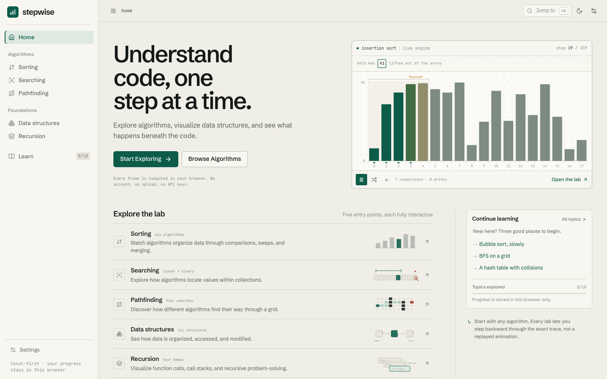
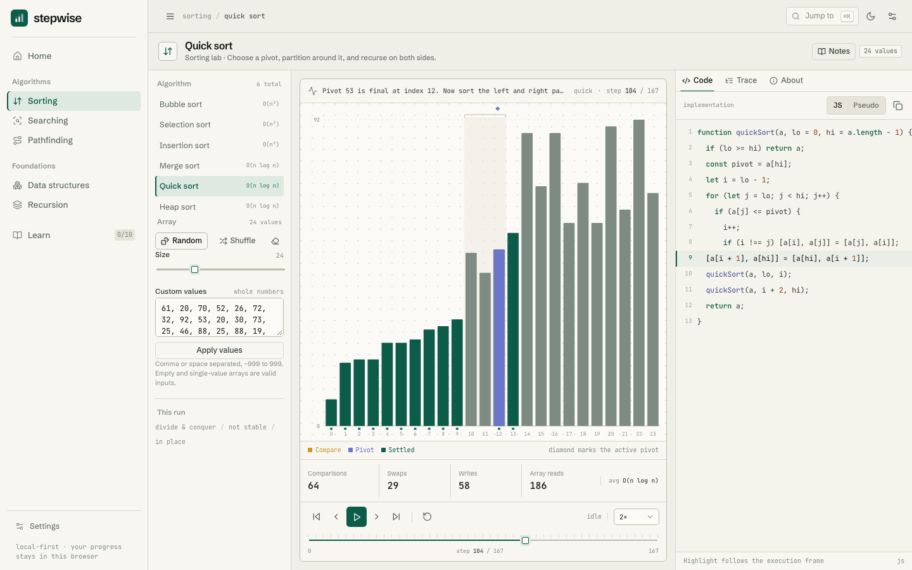
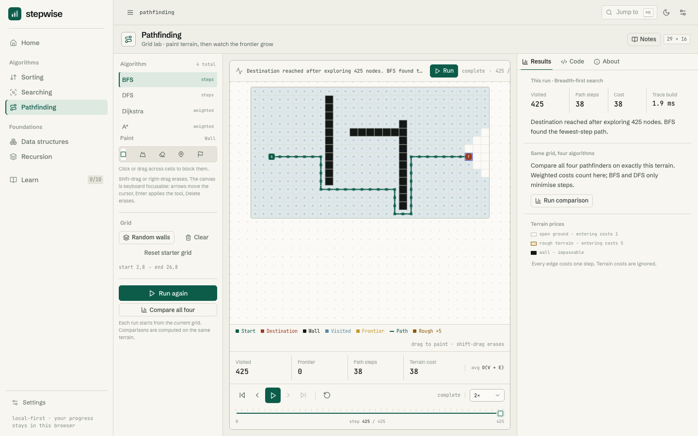
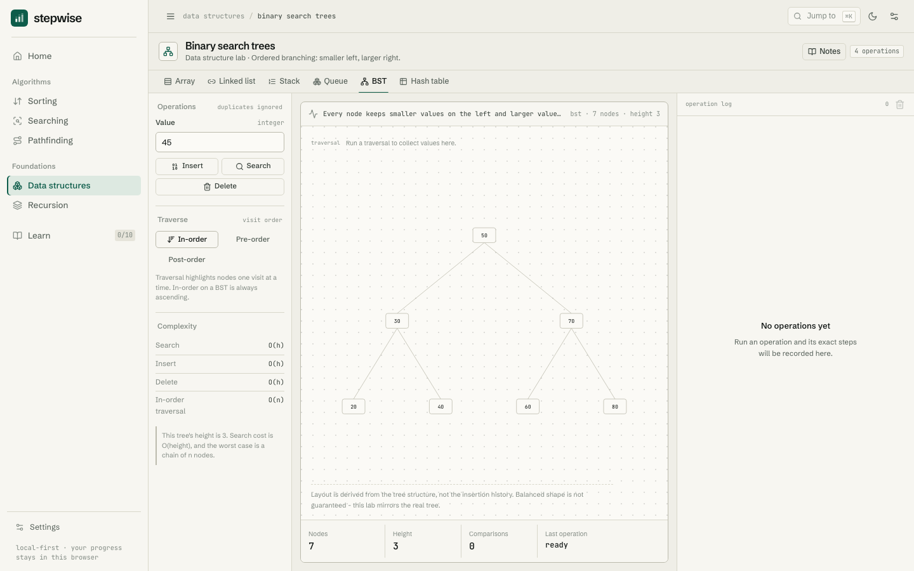

# Stepwise

Stepwise is an interactive lab for computer science. Watch sorting, searching, and pathfinding run one operation at a time, experiment with arrays, linked lists, stacks, queues, binary search trees, and hash tables, and follow recursive calls as they build and unwind.

Every visualization, counter, and code highlight is driven by the same implementation running in the browser.

## Visuals

